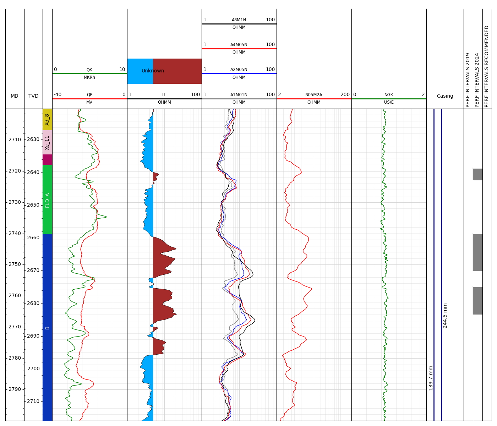
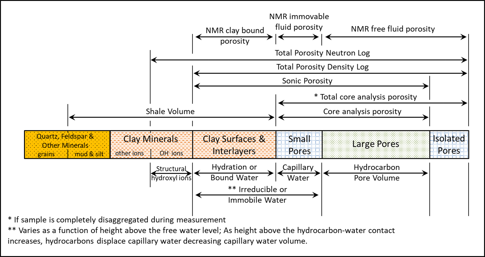
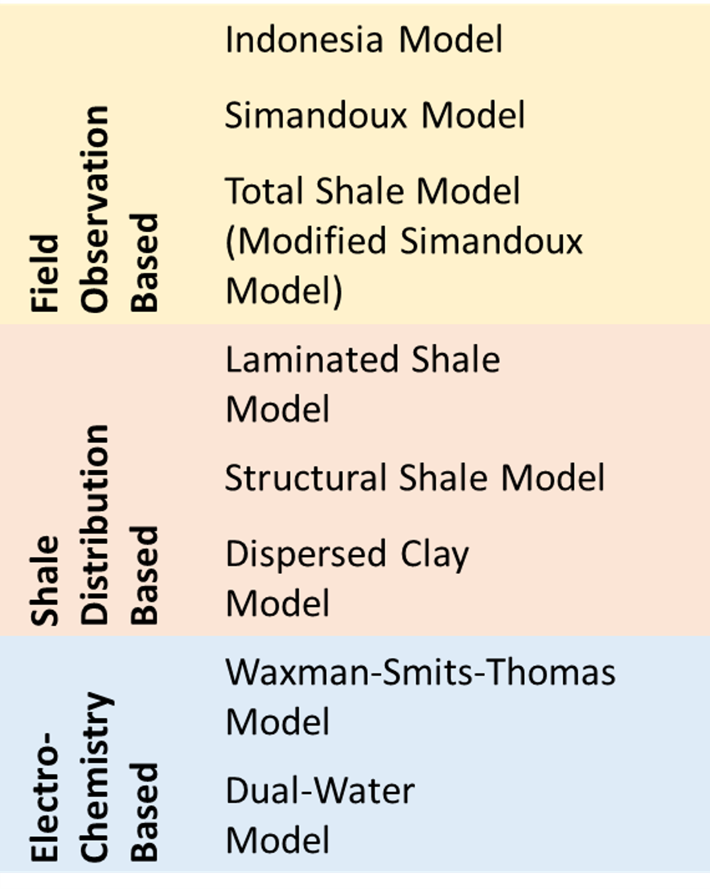
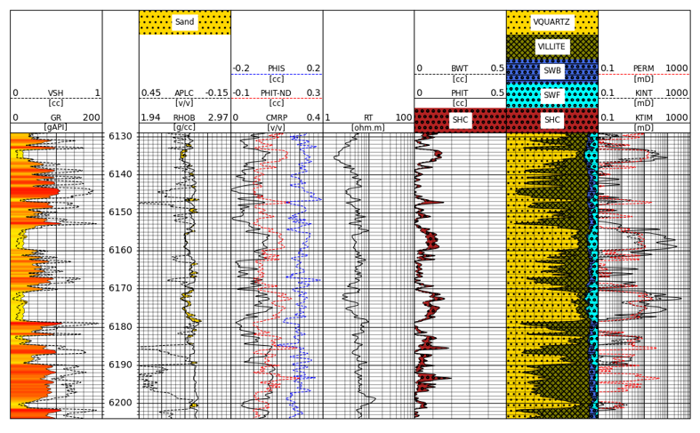

# Formation Evaluation

**An open, end-to-end well-log workflow for practicing petrophysicists.** Take a well from a raw LAS file or a paper scan, through quality control and interpretation, to report-ready one-page plots.

It has two interfaces:

- **Python:** the `pphys` package, scriptable and reproducible, and the engine behind everything here.
- **Browser:** no-code [apps on GitHub Pages](https://jshiriyev.github.io/formation-evaluation/) for the same workflow, without installing Python.

## The workflow

| Step | Tool | Status |
|---|---|---|
| Load LAS files | `pphys.read`, `pphys.load` return a `WellLog` (a lasio `LASFile` with `crop`, `resample`, `copy`), with optional caching | ✅ Ready |
| Check the data | `pphys.LasView`: inventory, coverage and gaps, statistics, QC flags, zone averages, quick-look plots and a PDF report | ✅ Ready |
| Plot one well | `pphys.onepage.WellView`: a one-page display like a logging-company print, with tracks, fills, lithology patterns, tops, casing and perforations | ✅ Ready |
| Interpret | `pphys.insight`: Rw, porosity, shale volume, Archie and shaly-sand saturation, permeability | 🚧 Being restored ([milestone 1](ROADMAP.md#1-working-interpretation)) |
| Digitize paper logs | `pphys.digitize.digitize()` and the `pphys-digitize` command: scanned PDF or image pages (PNG, JPG, TIFF) to a `WellLog`/LAS with QC images; several pages stitched by depth, several curves of any colour, track edges found automatically, linear or log10 scales; depth from manual depths or OCR of the labels | 🚧 QC plots to come ([milestone 3](ROADMAP.md#3-robust-digitizing)) |
| Do it in the browser | [GitHub Pages apps](https://jshiriyev.github.io/formation-evaluation/) | 🧪 WellView configurator; plotting needs the hosted service ([milestone 4](ROADMAP.md#4-backend-for-the-apps)) |
| Correlate wells | `pphys.onepage.CrossView`: several wells along a profile | 🚧 Needs a class for each well's tops ([milestone 2](ROADMAP.md#2-multi-well-crossview)) |

The [roadmap](ROADMAP.md) lists what "done" means for each open step.

## Install

`pphys` is installed from GitHub; it is not published on PyPI. It needs Python 3.10 or newer.

```bash
pip install "pphys @ git+https://github.com/jshiriyev/formation-evaluation"
# with the digitizer (also install the Tesseract OCR program separately):
pip install "pphys[digitize] @ git+https://github.com/jshiriyev/formation-evaluation"
```

With [uv](https://docs.astral.sh/uv/): `uv add "pphys @ git+https://github.com/jshiriyev/formation-evaluation"`.

## Quick start

Check a LAS file and draw a quick-look one-pager. The log is one of the samples in [`notebooks/`](notebooks/).

```python
from matplotlib import pyplot as plt

from pphys import LasView, read
from pphys.onepage import Lithology, WellView

las = read("notebooks/tutorial_3_graph_2.LAS")

qc = LasView(las)
print(qc.summary())
print(qc.quality())  # per curve: plausible limits, spikes, flat lines, gaps

view = WellView(las, ntrail=3, ncycle=2, depth={"limit": (1682, 1742)})
view.set(1, limit=(0, 150))  # gamma ray
view.set(2, limit=(0.2, 2000), scale="log10")  # resistivity

view(plt.figure(figsize=(6, 10)))
view.add_depths(0)
view.add_cut(1, "GAMMA", 60, left=Lithology.sandstone, right=Lithology.shale, color="green")
view.add_curve(2, "LLD", color="black")
view.add_curve(2, "MSFL", color="red", linestyle="--")
view.save("quicklook.png", dpi=150, bbox_inches="tight")
```

More:
- [`doc/wellview.md`](doc/wellview.md) is the WellView reference: tracks, scales, header rows, fills, tops, perforations, casing, MD/TVD and multi-page PDFs.
- [`doc/lasview.md`](doc/lasview.md) is the LasView reference.
- Worked notebooks:
  - [`wellview_onepager.ipynb`](notebooks/wellview_onepager.ipynb) builds a 12-track one-pager.
  - [`fill_styles.ipynb`](notebooks/fill_styles.ipynb) covers lithology, mineral and pore-space patterns.
  - [`lasview_real_field_data.ipynb`](notebooks/lasview_real_field_data.ipynb) checks a real cased-hole run.

## One-page displays

`WellView` puts a well's logs on one page with a shared depth axis. Its header lists every curve with its scale. It shows formation tops, casing and liner shoes, and perforation intervals, and its fill styles follow the standard graphic lithology key.



*Figure 1: The one-page display WellView targets. [`notebooks/wellview_onepager.ipynb`](notebooks/wellview_onepager.ipynb) builds one with the current version.*

`CrossView` lines up several wells along a profile, with their logs, tops, casing and perforations, for structural and stratigraphic correlation.


*Figure 2: A cross-section made with an earlier version of CrossView. Restoring it is [milestone 2](ROADMAP.md#2-multi-well-crossview).*

## Interpretation in shaly sands

The interpretation models are being brought back into working order ([milestone 1](ROADMAP.md#1-working-interpretation)). The figures below show what they are for.

Shale affects the log readings according to how much shale there is, what its properties are, and how it is distributed in the rock. A shaly formation can have a high total porosity but a low effective porosity.



*Figure 3: Porosity of a shaly sand measured by various methods (Cosentino, 2001).*

Archie's equation assumes that the formation water is the only conductor in the rock. Shale is a second conductor, so shaly formations need a modified equation or a different model. Many have been proposed. All of them reduce to Archie when the shale fraction is zero, and for small amounts of shale most give similar results. Others build on percolation theory (Herrick and Kennedy, 2009) and connectivity theory (Montaron, 2009; Lee, 2011).

<div align="center">
 
</div>

*Figure 4: Resistivity models for shaly sands that `pphys.insight` covers.*

Figure 5 shows the workflow on a gas well from the South Caspian Basin with a nearly complete log suite:
- **Porosity:** the neutron log is calibrated to limestone, and the overlay uses limestone properties. Total neutron–density porosity follows the NMR porosity in trend; the sonic porosity does not, as the literature leads one to expect.
- **Saturation:** the total-shale model (fifth track) agrees with the NMR saturation. Every value is above the 0.35 water-saturation cut-off, so the interval holds no hydrocarbon. This matches the test result (not productive) and the near-zero NMR gas saturation.



*Figure 5: Open-hole log interpretation of a well in the South Caspian Basin.*

## Development

The project is managed with [uv](https://docs.astral.sh/uv/).

```bash
uv sync          # create the environment, with every optional feature
uv run pytest    # run the tests
```

[`CLAUDE.md`](CLAUDE.md) describes the architecture and conventions.

## License

[MIT](LICENSE) © 2022–2026 Javid Shiriyev
